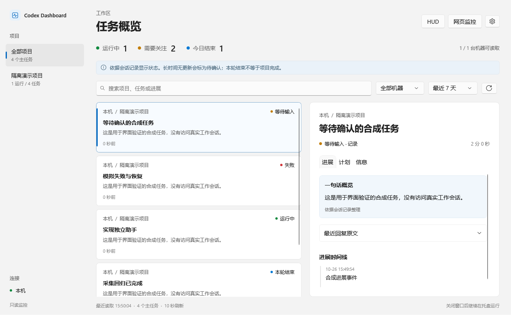

# Codex Dashboard

[](https://github.com/BeteixZ/CodexDashboard/actions/workflows/ci.yml)

在 Windows 桌面集中查看 Codex 任务，并通过独立助手查询进展、管理提醒和安排后续工作。

这是社区项目，与 OpenAI 无隶属关系。当前版本为 **v0.1.0 预发行版**，适合试用和反馈；复杂控制、恢复和长期运行仍有待验证。

## 两个独立的软件

| 软件 | 用途 |
| --- | --- |
| **Codex Dashboard** | 任务列表、项目与主机筛选、进展时间线、桌面 HUD、托盘状态、提醒，以及局域网 / VPN 网页监控。 |
| **Codex 助手** | 微信问答与任务查询、ChatGPT 账户登录、长期记忆、提醒与订阅、文件处理，以及按配置开放的 Codex 任务控制。 |

两者分别安装、运行和保存数据。只需要监控时可以只装 Dashboard；关闭其中一个不会自动退出另一个。本机配对只交换健康和能力状态，不传递聊天正文或凭据。



界面示例使用合成任务，不包含真实会话。安装后可按自己的主机、项目和任务筛选。

## 安装

从 [Releases](https://github.com/BeteixZ/CodexDashboard/releases) 下载对应产品的 **Windows x64 安装程序**，双击后按提示完成安装。

- Dashboard：`CodexDashboard-0.1.0-win-x64-Setup.exe`。
- 助手：`CodexAssistant-0.1.0-win-x64-Setup.exe`。
- 安装包包含所需的 .NET 运行环境和本机采集用 Python，无需另装 .NET SDK 或 Python。
- 新安装分别使用独立数据目录，不自动接管旧版设置、微信绑定或凭据。
- 当前安装程序**尚未数字签名**，Windows 可能显示未知发布者。发布页提供 SHA-256 校验值；校验值只能核对文件一致性，不能代替发布者签名。
- 当前没有自动更新；升级需下载新安装程序。卸载保留独立用户数据。
- 远程监控另需可用的 SSH、远端 Python 3 和可读取的 Codex 环境。

完整步骤见 [开始使用](docs/getting-started.md) 和 [安装与升级](docs/product-installation.md)。

## 可以做什么

**Dashboard**：查看本机与已配置远程主机的任务，按状态、项目和关键词筛选；在紧凑 HUD 或托盘查看近期任务；从任务详情读取最近回复和计划。网页监控提供只读视图，访问链接包含密钥，应只在可信局域网或 VPN 使用。

**助手**：通过微信发送“状态”“任务列表”“当前任务”“报告”等消息；使用 ChatGPT 账户授权进行问答和自然语言理解；保存、修改、删除长期记忆；创建提醒、订阅和满足条件后继续工作的安排。模型调用使用所选账户的额度。

任务控制按具体后端和可信配置开放。新建、续跑及重启后恢复原任务的基础链路已有实际验证；它不意味着所有审批、远程环境、网络中断和恢复场景都已通过。

## 当前限制

- 正式旧版迁移、接收者交接、恢复服务启用和兼容回滚尚未形成完整产品流程。
- 复杂手机交互、共享远程控制、长期调度和长时间运行仍需进一步验收。
- 提醒需要助手保持运行；接口受理不等于手机已经收到。
- 语音使用微信随附转写；没有独立音频识别或语音回复。
- PDF 只读取文字层，不含 OCR；macOS 暂不支持。

详见 [已知限制](docs/known-limitations.md)。

## 从源码构建

需要 Windows、PowerShell 7 和 .NET 10 SDK。在仓库根目录运行：

```powershell
./Build-Products.ps1
```

输出位于新的 `artifacts/builds/<时间>/dashboard` 和 `assistant` 目录。这个开发构建入口与公开的自包含安装包不同，默认开发产物仍需本机运行环境；运行和安装方式见 [安装文档](docs/product-installation.md)。构建不会自动替换正在使用的程序或迁移用户数据。

## 文档与贡献

- [开始使用](docs/getting-started.md)
- [安装、升级与卸载](docs/product-installation.md)
- [已知限制与验收范围](docs/known-limitations.md)
- [更新记录](CHANGELOG.md)
- [参与开发](CONTRIBUTING.md)
- [安全问题](SECURITY.md)
- [发布流程](docs/releasing.md)
- [项目发展概述](docs/development-history.md)

本项目使用 [MIT 许可证](LICENSE)。依赖及其许可证见 [第三方声明](THIRD-PARTY-NOTICES.txt)。
